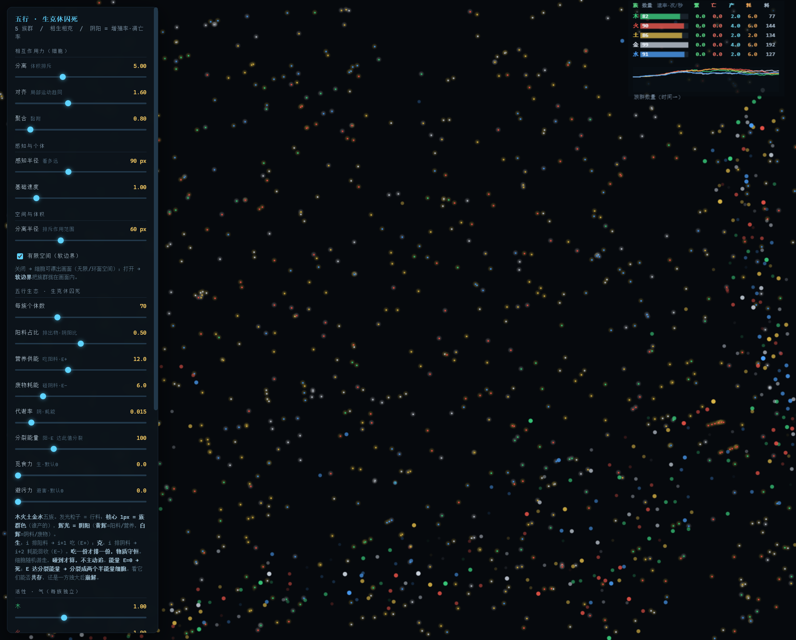
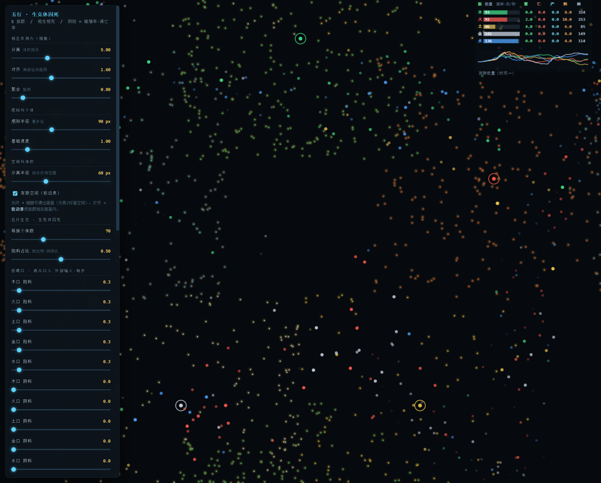
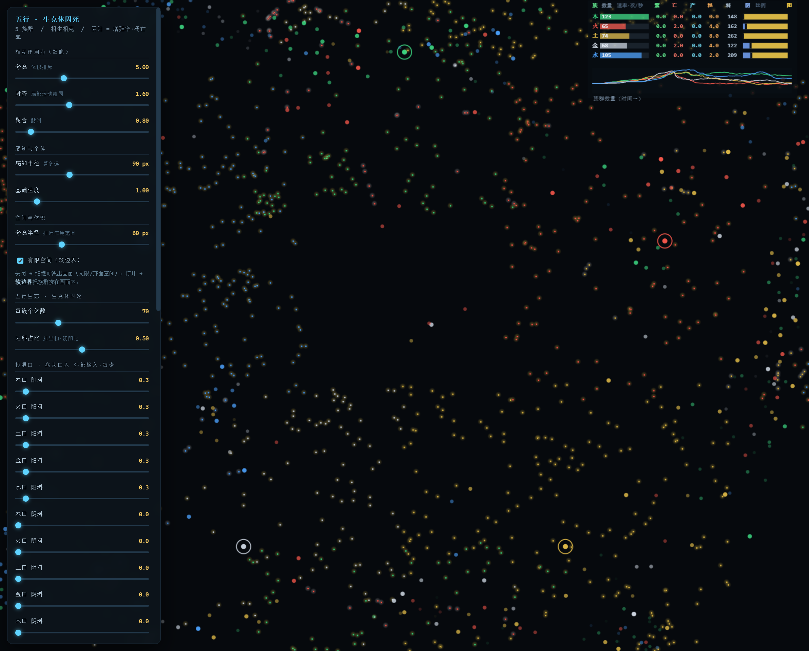

# 从「咬死」到「排污」：一次范式转变

### —— 兼与循环竞争（Lotka-Volterra 推广 / 石头剪刀布）的一对一对比

> **作者**：煊（老邓）· hemo
> **日期**：2026-10-15
> **对应实现**：`index.html`（v2「阴阳料」版）
> **关系**：本文修订并取代 `paper.md` §2.2 的模型描述（v1 的"生克 = 物质循环 vs 能量捕食"）

---

## 摘要

> **我们一直把「克」理解错了。**

v1 把「克」建成了**捕食**：族群 `i` 追捕 `i+2`，相碰即吞噬（猎物死，捕食者得能量）。
这一版把它改成**排污与代偿**：一行产出的「废料」流向下游，下游要**花能量**去处理它。

> **克不是"我杀死你"，而是"你替我还熵债"。**

这一步逼出了三个连锁改动，本文先讲清楚它们（§1），再把模型与**循环竞争**逐项对照（§2），并诚实标出哪些是"同构"、哪些只是"形似"（§3）。

---

## 1. 这一版改了什么（v2）

### 1.1 核心：行为「行料分阴阳」

**生与克，不再是"两种关系"，而是"同一种料流的两个符号"。**

| | 载体 | 流向 | 效果 |
|---|---|---|---|
| **阳料**（营养，黄辉）| 粒子 | `i` 产 → **`i+1` 吃掉** | **增益**：能量 `E +`（养身 / 供能）|
| **阴料**（废物，白辉）| 粒子 | `i` 产 → **`i+2` 碰到** | **减益**：能量 `E −`（花能量处理它）|

其中 `i+1` 是"我生者"，`i+2` 是"我克者"。**验证**（用五行循环核对）：

- 火阳料 → 土（火生土）✓
- 火阴料 → 金（火克金）✓
- 土阴料 → 水（土克水）✓

**三个原来解释不了的事，现在能解释了：**

1. **食物分阴阳** —— v1 里所有"料"都是好的（吃了就涨），**没法解释"吃错东西会生病"**。
   米饭是阳料（补土），酒是阴料（毒，耗肝）—— 同一口"吃"，正负相反。
2. **克为什么是"制约"而非"杀死"** —— "让你花能量处理我的垃圾" = 约束，不是灭绝。这才是"克"的本意。
3. **太过 / 不及有了新物理** —— 太过 = 产废太多、压垮下游；不及 = 产营养太少、饿死下游。

> **阴阳在两个尺度上一致**：个体层是 `E` 增 / 减，行间层是营养料 / 废料。
> **阴阳不是某一层的概念，是"增益 vs 减益"的普遍符号。**

### 1.2 单能量账户：能量是唯一的货币

| | v1 | v2 |
|---|---|---|
| 账户 | 双账户：`E`（能量）+ `M`（物质）| **单账户：`E`** |
| 死 | `E ≤ 0` | **`E = 0` → 死** |
| 分裂 | `M ≥` 阈值 | **`E = 100` → 分裂成两个 `E = 50`**（能量守恒的对半切）|

**分裂是守恒的**：100 拆成 50 + 50，系统总能量在分裂那一刻不变。

### 1.3 物质严格守恒：吃一份，才排一份

v1 里"产出"是**凭空**的（每个体每 tick 固定概率产料）→ 料无限增殖 → 堆满上限。

v2 改成 **1 进 1 出**：

```
只有吃进一份阳料，才排出一份自己的废物（阴料）。
系统内物质总量恒定 = seedMat（初始撒入量）。
```

实测：物质总量**恒为 1000**，不再增殖。

### 1.4 开放系统：投喂口（"病从口入"）—— 这才是耗散结构

**热力学是绕不过去的。** 物质守恒 + 细胞移动/代谢做功生热（不可逆散到系统外）
→ **系统总能量单调下降 → 断供必然全死。**

所以补上**能量入口**：5 个投喂口，每步从外部注入。

- **投喂 = 外部能量**，把系统里的**废物（阴料）回收成营养（阳料）**（像阳光 / 光合）
- **投喂为 0 = 断供** → 阳料耗尽 → 全死（**耗散结构的热力学宿命**）

> 这正对薛定谔"生命以负熵为食"、普里高津"耗散结构需要持续能量流"。
> **我们的模型"必然全死"，恰恰证明它是耗散结构，而不是能量永动机。**

### 1.5 可视化

- **行料 = 发光粒子**：核心 1px = 族群色（谁产的）；辉光 = 阴阳（黄辉 = 阳料，白辉 = 阴料）
- **阴阳比例条**：监视器每行一条，左阴（蓝）右阳（黄），**分界线位置 = 比例** —— 把"阴阳 = 比例"这句话画出来
- **右下角规则图例**：把生 / 克 / 生死 / 投喂 / 守恒 / 五行循环写在画面上


*图 1：深色底上的"星空"—— 每个发光粒子的核心是族群色（红=火产/绿=木产/蓝=水产…），辉光表阴阳（黄辉=营养，白辉=废物）。*


*图 2：5 个投喂口（环上的大圆圈）向周围散布行料；右侧监视器最右列为「阴阳比例条」。*


*图 3：每行一条"左阴右阳"的比例条，中间一道断口 —— 竖排五条，形似"爻"（但这是形似，非复现六爻）。*

### 1.6 实测（默认参数，约 200 秒）

| 观测量 | 结果 |
|---|---|
| 种群总量 | 350 → 涨到 ~800 → **稳在 ~500**（投喂 0.3 档）|
| 物质总量 | **恒为 1000** ✓ |
| 投喂谱 | `0.1 饿（偏枯）` / `0.3 补（均衡）` / `1.5 撑（过亢·暴胀到 3800+）`|
| 断供 | 阳料耗尽 → 种群崩（**必死**）✓ |
| 阴阳比例条 | 土那一行"蓝最多"（阴 36%）—— 被木压得最狠，一眼可见 |
| 补阴料 | 给水投"土型阴料"（土克水）→ 水族群总能量 **4159 → 2600（−37%）** ✓ |

### 1.7 自毒振荡：阳太过 → 上火 → 退烧

**这是我们没预设、但稳定复现的现象。**

长时间跑（默认参数，300 秒）会发现：系统**整体有界**（种群在 350~839 之间），
但**局部一直在脉冲** —— 平均每 ~15 秒一轮"兴盛-崩溃"（实测 17 峰 18 谷，周期 3~45 秒不等）。

**机制（延迟负反馈）：**

```
① 纯阳期   投喂口把废物回收成营养 → 阳料充足 → 吃 → 分裂 → 种群膨胀
           ↑ 正反馈：越多越吃，越吃越分裂
② 副作用   每个个体吃一份 → 排一份废物（物质守恒！）→ 排污速率 ∝ 个体数
③ 临界点   个体太多 → 排污速度 > 投喂口回收速度 → 阴料净积累
④ 反噬     阴料堆积 → 碰到就掉能量 → 死亡潮（died 速率突增）
⑤ 回落     大量死亡 → 排污减少 → 阴料被回收光 → 回到纯阳 → 回到 ①
```

**它与"断供必死"是一对**：

| | 下限 | 中间 | 上限 |
|---|---|---|---|
| 条件 | 断供（投喂=0）| 投喂适中 | 过亢（投喂=1.5）|
| 命运 | **饿死**（阴尽阳无源）| **有界振荡 = 稳态 = 活着** | **撑爆**（冲到上限后崩）|

> **稳态的本质不是"不动"，是"有界地来回"。** "上火发烧"就在中间这一层 —— 它不是病，是活着的一部分。

**与中医的对应：**

| 中医 | 模型 |
|---|---|
| **阳太过** | 纯阳期，种群冲高、出生速率飙升、有细胞能量逼近阈值（准备分裂）|
| **壮火食气 / 气有余便是火** | "旺"本身制造废物，**自己烧自己**（不需要外邪）|
| **亢则害，承乃制，制则生化** | 亢盛 → 排污堆积 → 死亡潮压制 → 回到新平衡 |

> 《素问·六微旨大论》：**「亢则害，承乃制，制则生化。」**
> 本模型给出了这句话的一个**动力学实现**：过度亢盛必然招致自我抑制，而抑制之后才有新的生化。

### 1.8 自发对称破缺：环的方向是一枚硬币

**现象**（用户观察）：稳态时细胞沿边缘成环旋转，且**看起来总是顺时针**。

**检验**（可证伪）：

| 检验 | 方法 | 结果 |
|---|---|---|
| 存在旋转吗 | 测总角动量 \|L\| | **真** —— \|L\| 达 300~600，强旋转 |
| 尺子准吗 | 人为布置顺/逆流标定 | +L=顺时针 / −L=逆时针 ✓ |
| **总是顺时针吗** | **42 次独立运行数符号** | **21 顺 : 21 逆 = 精确 50/50** ❌ |
| 单次运行内稳定吗 | 记录 (t, 阴料, L) 时间序列 | **稳定** —— 一次运行内从不翻转 |
| 能掰过去吗 | 中途加反向切向脉冲 | **8/8 掰过去**（两个方向都能掰）|
| 有势垒吗 | 扫脉冲强度 0.02~3.0 | **有** —— 0.05 弹回(0/3)，≥0.5 必掰(3/3)|
| 掰过去后保持吗 | 掰后测 5 个时间窗 | **保持** —— 全程不回翻（迟滞）|

**结论**：**"总是顺时针"不成立。** 真相是 ——

> **方向由系统的随机涨落决定，一旦选定就锁死；单次运行内看不到它翻面，于是"感觉"总是顺时针。**
> **它是一枚立起来的硬币。**

**这在物理上叫「自发对称破缺」（spontaneous symmetry breaking）：**

- **规则是左右对称的**，但**宏观态自己选了一边**
- 两个方向都是稳定态（**双势阱**）→ 有**势垒**（小扰动弹回）
- 状态有**记忆**（掰过去就保持）→ **迟滞**

**就像磁铁**：物理定律左右对称，但每块磁铁自发选一个磁化方向。

**一个未解的细节**：掰过去后旋转强度会**缓慢衰减**（如 615→507→371→293→322），
环在慢慢变弱 —— 它最终会停，还是被下一轮 boom-bust 重新抽签？**待查。**

---

## 2. 与「循环竞争」的一对一对比

### 2.1 先说清对方是什么

**循环竞争（cyclic competition）** 是生态学里解释"多物种共存"的核心模型，别名
**石头剪刀布（Rock-Paper-Scissors, RPS）**：

> A 压制 B，B 压制 C，C 压制 A → **没有绝对强者，谁抬头就被上一家摁下去 → 循环共存。**

数学上它就是 **Lotka-Volterra 竞争方程**的一个特例（交互矩阵反对称；**May & Leonard, 1975**）。

**关键文献事实**（本节引用的，均为已发表结论）：

| 结论 | 出处 |
|---|---|
| A 压制 B、B 压制 C、C 压制 A 的数学形式 = Lotka-Volterra | Itoh (1973) |
| **全局交互（well-mixed）+ 有限种群 → 三物种不能共存** | Itoh (1973) |
| **局部交互（格点 / 空间结构）→ 三物种稳定共存** | Tainaka |
| 循环竞争的一般理论（反对称 / 异宿环）| May & Leonard (1975) |
| **5 物种**循环竞争（"Rock–Paper–Scissors–Lizard–Spock"）| Avelino 等；Feng 等（自发螺旋波）|
| 循环可由**任意奇数**物种构成 | Allesina & Levine (2011)；Vandermeer (2011) |
| 零和 RPS 的"**最弱者定律**"（增长率最低者最可能胜出）| 多篇（非马尔可夫 RPS 等）|

### 2.2 逐项对比

| 维度 | 循环竞争 RPS / LV | 五行涌现 v2 | 同 / 异 |
|---|---|---|---|
| **实体** | `N` 个物种（种群）| 5 个功能族群 | **同构**（都是"实体环"）|
| **交互结构** | 单一循环 `A→B→C→A` | **两条独立闭环**：相生 `+1`、相克 `+2` | **异**（我们是双环）|
| **交互性质** | **捕食即繁殖**（predation with reproduction），**零和**：猎物被杀死并**被顶替** | **排污与代偿**：不杀死，下游**花能量**处理废物 | **异 · 核心**（见 §2.3）|
| **交互矩阵** | 反对称（May-Leonard）| 生：`i → i+1` 供给；克：`i → i+2` 减益 | 部分同（都含反对称成分）|
| **物种数 = 5** | 5 物种循环（Lizard-Spock）| 五行 = 5 | **同**（都是 5，但理据不同，见 §2.4）|
| **空间** | well-mixed 有限种群会灭；**有空间才共存** | 有空间（boids 域，局部交互）；稳态成环，方向自发对称破缺（§1.8）| **同**（都靠空间维持共存）|
| **动力学形态** | 中性稳定 / 异宿环 / 螺旋波 / 周期振荡 | **耗散结构稳态 = 有界的自毒振荡**（见 §1.7）| **部分同**（都含振荡，但机制不同，见 §2.5）|
| **守恒量** | 有（如 `A = uvw/(u+v+w)³`）| **物质守恒**（总量恒 = seedMat）| **各有一个守恒量** |
| **个体的"死"** | 被捕食 = 死（外部事件）| **能量归零 = 死**（内部账户）| **异**（我们死亡是内生的）|

### 2.3 最锋利的分野：捕食 vs 排污

经典 RPS 的交互是 **"predation with reproduction"** —— 在一个捕食事件里：

> **猎物被杀死，并立即被捕食者顶替**（零和：一死一生，总数不变）。

我们的「克」是 **排污 / 代偿**：

- 上游**不杀死**下游（下游还在）
- 上游产**废物**，下游**碰到就掉能量**（花能量处理）
- **不是零和** —— 没有"猎物被顶替"这一环
- 这个"减益"发生在**能量账本**上，不是"杀死 / 顶替"

> **一句话：我们的"克"里，没有 RPS 的"猎物被顶替"。**
> 它是一个**非零和的、能量减益的耦合** —— 这正是那句原话：**"克不是捕食，是排污与代偿。"**

这个差异**不是缺陷**：它让"制约（克）"得以独立于"消灭"存在 ——
而这恰恰是中医"克是制约、不是杀死"的动力学落点。

### 2.4 "5"的两个理据（别混同）

两个"5"看起来一样，**来源完全不同**：

| | RPS 的"5" | 我们的"5" |
|---|---|---|
| 来源 | 3 物种 RPS 的**自然推广**（任意 N 都行）| **命题 1**（两条链必须分离）|
| 约束 | 无特殊拓扑约束 | 相生 `+1` 与相克 `+2` **都要是覆盖全体、彼此独立的单循环** → 最小 `n = 5` |
| 为什么是奇数 | May-Leonard 异宿环的便利 | `gcd(2, n) = 1` 使 `+2` 也是单循环 |

**诚实标注**：我们的"5 是下界"是一个**拓扑命题**，**不是**从 RPS 借来的。两者指向同一现象（循环竞争的物种数不平凡），但**理据不是同一个**。

### 2.5 振荡机制的差异（修订 §2.2）

> ⚠️ **修订**：§2.2 初稿写"我们是稳态、RPS 是振荡"，标为"异"。
> §1.7 发现长期也在振荡后，这个判断需要修正。

**两者都会振荡，但机制不同：**

| | RPS / May-Leonard | 五行涌现 v2 |
|---|---|---|
| 振荡来源 | **异宿环**：种群轮流接近"只剩一种"的鞍点，再被下一个物种翻转 | **自毒延迟负反馈**：个体污染公共环境（阴料），反噬自己 |
| 周期 | 由物种间的竞争参数决定 | 由"排污速率 vs 回收速率"的失配决定 |
| 振幅 | 可趋于"谁快赢谁"的翻转（有限种群会灭）| **有界**（实测 350~839，不会冲到灭绝或上限）|
| 是否存在稳态 | well-mixed 会灭；有空间才共存 | 有**有界振荡的稳态**（投喂适中档）|

> **共同点**：都靠"负反馈"把系统摁在一个窗口里。
> **不同点**：RPS 的负反馈是**物种间的**（A 压 B、B 压 C 循环）；
> 我们的负反馈是**环境中介的**（排污 → 公共池 → 反噬排污者自己）。
> 后者更像"**公地悲剧 + 自限**"，前者是"**循环压制**"。

**这个修订让两者更接近了**，但注意：
**"都会振荡"不等于"机制相同"** —— 一个走异宿环，一个走公地自毒。

---

## 3. 诚实的边界

1. **我们不是"复现"循环竞争。** 模型是从一个具体直觉长出来的（"细胞是个体、五行是种群、阴阳是两路料流"），
   Lotka-Volterra 是**事后能对上的语言**，不是出发点。**形似 ≠ 同源。**
2. **本次对比是"类比"，不是"等价"。** §2.2 里标"异"的项（尤其"排污 vs 捕食"）是**真实差异**，不该被抹平。
3. **参数是唯象的**，不来自生理测量；所有结论都是**定性可复现、定量混沌**。
4. 本文只做**一对一映射**，**没有**做 RPS 文献里的定量比对（如稳定性判据、异宿环分析）——
   那是下一步（§4）的事，现在不敢下结论。

---

## 4. 下一步（待验证）

- [ ] **把"排污式相克"写成方程**，看它的稳定性判据与 May-Leonard 差在哪
- [ ] **验旧实验**：相乘相侮、物极必反、死序混沌 —— 在"排污相克"下是否仍成立
- [ ] **给每行加 per-type 的"阳料 / 阴料产出率"**（现在比例是全局的，造不出"某一行偏枯"）
- [ ] 与 RPS 文献做一次**定量**对照（守恒量、异宿环、最弱者定律）
- [ ] **查 §1.8 的未解细节**：掰过去后旋转强度缓慢衰减（615→507→371→293→322），环会停吗？
- [ ] **查 §1.7 的周期分布**：boom-bust 周期 3~45 秒不等，是内在混沌还是参数噪声？（需多轮重复）

### 已完成（本轮）

- [x] §1.7 **自毒振荡**：阳太过 → 上火 → 退烧（延迟负反馈，实测 17 峰 18 谷）
- [x] §1.8 **自发对称破缺**：环的方向是硬币（42 次 21:21、双稳态、势垒、迟滞）
- [x] §2.5 **修订** §2.2 的动力学判断（稳态 → 有界的自毒振荡）

---

## 附：一句话总结

> **v1 把"克"建成捕食，v2 改成排污。**
> **改完之后，生与克是同一种料流的正负两端；**
> **而它跟循环竞争最本质的区别是 —— 我们的"克"不杀死对方，只是让对方替我处理熵债。**
