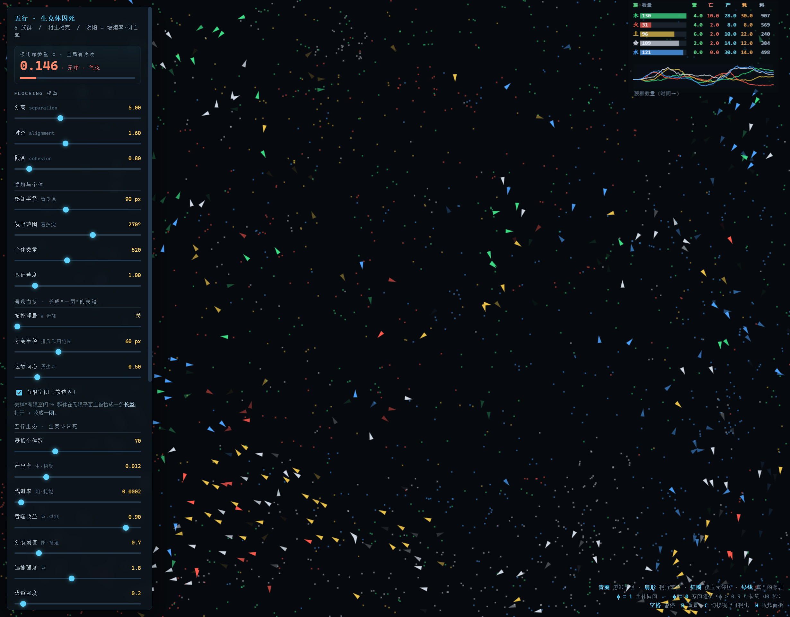
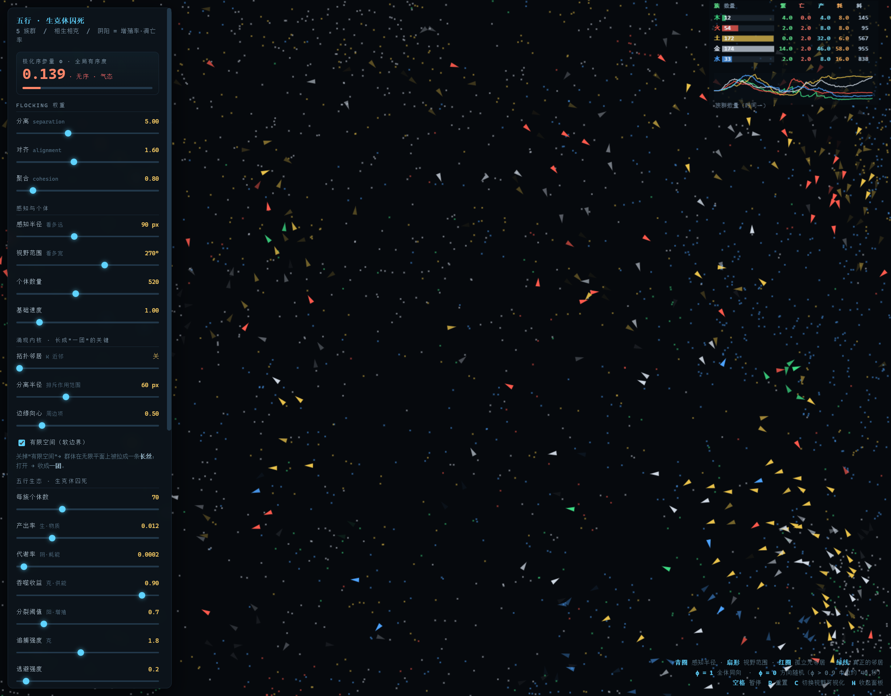
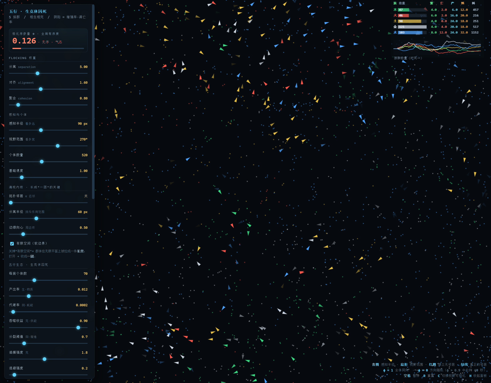
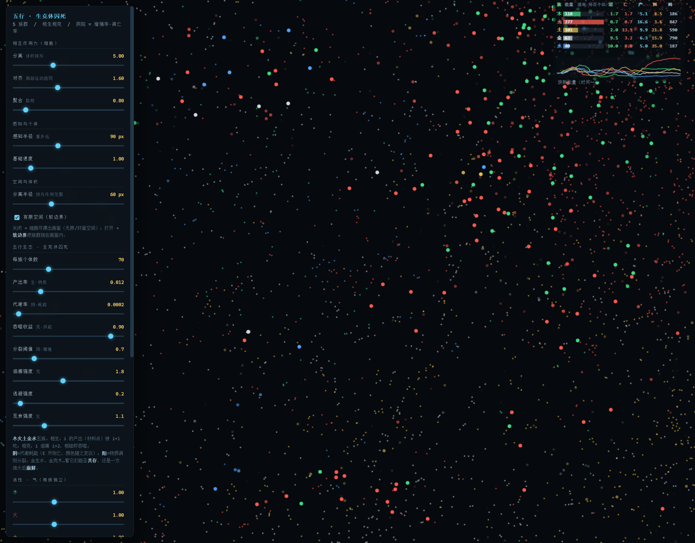
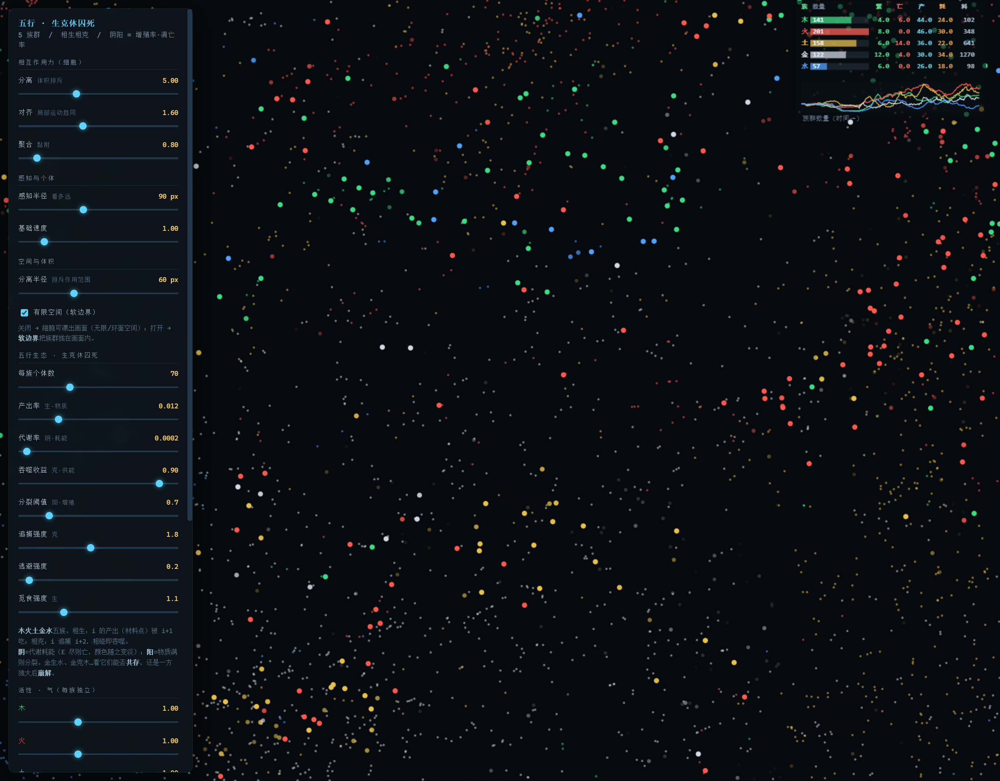

# 五行是不是一套合法的动力学语法？

### —— 一个数值实验：从鸟群沙盘到"生克休囚死"的可计算失衡理论

> **作者**：煊（老邓）· hemo
> **日期**：2026-10-15
> **在线演示**：打开仓库首页 `index.html`（自包含，浏览器直接运行）
> **原始实验笔记**：[NOTES.md](./NOTES.md)（22 节完整数据）

---

## 摘要

本文提出一个**极简的 N 体生态模型**，用来检验一个具体问题：

> **"阴阳五行"能不能被当作一套可计算、可证伪、可预测的动力学语法？**

模型把"五行"读作 **5 个功能族群**，把"阴阳"读作**增殖率 / 凋亡率**（而非"寒热虚实"两种态），把"生克"读作**种群间的物质供给与能量捕食**。个体不用计时器、也不用固定概率繁殖死亡 —— **出生与死亡是"资源账户"的输出**。

在这个模型上，我们**实测复现**了多条传统中医的定性预言，并且发现它们分别对应动力学中成熟的概念：

| 中医表述 | 动力学对应 | 本文证据 |
|---|---|---|
| 生克休囚死 | 耗散结构：流断则结构塌 | §3.1 |
| 相乘相侮 | 克链负反馈被破坏 → 扰动单向瀑布 | §3.2 |
| 物极必反 / 重阴必阳 | 延迟负反馈 → 滞后振荡 | §3.3 |
| 太过 / 不及 | **对称性破缺**（某行参数偏离）| §3.4 |
| 旺衰（气）| 个体的**活性**（移动速度）| §3.5 |
| 虚则补其母 / 母病及子 | 生链是**供给链** | §3.7 |
| 头痛医头之误 | 单行干预打破比例 → 链式崩溃 | §3.7 |
| 同病异治 / 辨证论治 | 确定性**混沌**：规律稳、路径乱 | §3.8 |
| 附子回阳救逆 | 打通**传输通道**（不是提高消耗）| §3.7 |

**结论（诚实的）**：本模型证明的是 **"阴阳五行是一套合法的动力学语法"**（能算、能证伪、能预测），**不是**"古人的宇宙观被证实"。它的**定性预言稳定可复现**，而**定量轨迹是混沌的** —— 这正是生命系统的真实性质：**规律清晰，个体不可复制。**

---

## 1. 引言

### 1.1 一个具体的疑问

传统五行观是一种**静态结构图**：人体 → 5 层属性 × 阴阳两态 → 生克是给定的关系。

这种表述在科学上有个尴尬：**它只有"态"，没有"流"**。而"生"和"克"在字面上都是**动词** —— 只有动力学量之间才有"流"。

于是问题变成：

> 如果阴阳不是"态"而是"率"，五行会不会**必然**长成一个动力系统？它能算出什么？它的预言能不能被证伪？

### 1.2 关键转换：把"态"换成"率"

| | 传统读法 | 本文读法 |
|---|---|---|
| 五行 | 5 类属性 | **5 个功能族群** |
| 阴阳 | 寒热 / 虚实（态）| **增殖率 / 凋亡率**（率）|
| 生克 | 给定的关系 | **种群间的相互作用**（供给 / 捕食）|

**这一步是全部工作的支点**：若阴阳是"态"，五行只能是挂上去的玄学；若阴阳是"率"，五行**必然**是动力学系统。

---

## 2. 模型

### 2.1 "5"的拓扑下界（命题 1）

五行编号 0~4：相生链步长 +1（0→1→2→3→4→0），相克链步长 +2（0→2→4→1→3→0）。

**问**：最小 n 是多少，能让两条链都构成**覆盖全体的、彼此独立的单向闭环**？

| n | 步长 2 的环 | 结论 |
|---|---|---|
| 3 | 0→2→1→0 | 是闭环，但**就是步长 1 的倒着走**（2 ≡ −1 mod 3）→ 生与克是**同一个**关系 |
| 4 | 0→2→0，1→3→1 | **断裂成两条**（gcd(2,4)=2）→ 不成单一闭环 |
| **5** | 0→2→4→1→3→0 | **单环，且与步长 1 不同** ✅ |

> **命题 1**：5 是"同时容纳两条独立闭环"的最小数目。（7 也可以，5 是最小。）

→ **"5"不是神秘数字，是拓扑下界。**

### 2.2 生与克：营养增益 vs 废料减益（v2 修订）

> ⚠️ **v2 修订（2026-10-15）**：本节原把「克」读作**捕食**（`i` 追捕 `i+2`，相碰即吞噬）。
> 后经修正，**「克」应为排污与代偿**。完整论述见 [`cyclic-competition.md`](./cyclic-competition.md)。
> 下表为 v2 版本，取代原文。

**生与克，是同一种"料流"的两个符号：**

| | **阳料（生·营养，黄辉）** | **阴料（克·废物，白辉）** |
|---|---|---|
| 载体 | 行料粒子（静止、守恒）| 行料粒子（静止、守恒）|
| 流向 | `i` 产 → **`i+1` 吃掉** | `i` 产 → **`i+2` 碰到** |
| 效果 | **增益**：能量 `E +` | **减益**：能量 `E −`（花能量处理）|
| 性质 | 物质·营养循环 | 废物·代偿 | 
| 生态学 | 生物地球化学循环 | 排污 / 代谢 |

> **生与克不是两种关系，而是同一种料流的正负两端。**
> **克不是"我杀死你"，而是"你替我还熵债"** —— 下游花能量处理上游的废物。

**关键结构**：阴阳在两个尺度上一致 —— 个体层是 `E` 增 / 减，行间层是营养料 / 废料。
**阴阳不是某一层的概念，是"增益 vs 减益"的普遍符号。**

**能量入口**：模型是**开放系统**（v2）—— 投喂口从外部注入能量（把废物回收成营养）。
**断供 → 纯耗散 → 必然全死**（耗散结构的热力学宿命）。

### 2.3 引擎（`index.html`，单文件自包含）

> ⚠️ **引擎已升级到 v2**（阴料 / 单能量账户 / 守恒 / 投喂口）；下述为 v2 描述。

- **5 个族群**（木火土金水），每个由若干圆形"细胞"个体组成。
- **行料分阴阳**：
  - **阳料（营养）**：`i` 排出 → **`i+1` 吃掉** → 能量 `E +`
  - **阴料（废物）**：`i` 排出 → **`i+2` 碰到** → 能量 `E −`（花能量处理 = 相克）
- **单能量账户**（唯一货币）：
  - **死**：`E = 0` → **死**（颜色随 `E` 变淡，alpha→0 即亡）
  - **分裂**：`E = 100` → **分裂成两个 `E = 50` 的细胞**（能量守恒的对半切）
- **物质严格守恒**：吃一份才排一份（1 进 1 出），系统总量恒 = `seedMat`。
- **开放系统**：**投喂口**从外部注入能量（把废物回收成营养）；**断供 → 必然全死**。
- **关键**：出生/死亡**不用计时器、不用固定概率**，而是**"资源账户的输出"**。
  - 否则"休囚死"永远涌现不出来 —— **答案会被写进参数里**。
- **个体是细胞，不是鸟**：圆形、各向同性感知、无朝向、无转身速率（见 §3.5 注）。

| 参数 | 默认 | 含义 |
|---|---|---|
| `metabolism` | 0.015 | 每 tick 能量消耗 ↑ → 滑向死态 |
| `splitE` | 100 | **阳**阈值 ↓ → 过度增殖（亢）；分裂成两个 `E/2` |
| `E0` | 50 | 初始能量 |
| `pYang` | 0.5 | 排出物中阳料占比（严格 1 进 1 出）|
| `seedMat` | 1000 | 初始行料总量（守恒系统的物质总量）|
| `nutrientE` | 12 | 吃一份阳料 → `E +` |
| `yinCost` | 6 | 碰一份阴料 → `E −`（相克）|
| `feedYang` / `feedYin` | 0.3 ×5 / 0 ×5 | 投喂口：外部注入（断供 = 0）|
| `feedR` | 320 | 投喂散布半径 |
| `forageGain` | 1.2 | 觅食阳料强度（生）|
| `typeSpeed` | [1,1,1,1,1] | **活性（气）**，每族独立（§3.5）|

---

## 3. 可复现的结论（已证实）

> 本章所有结论均可用 `index.html` 重跑复现；数据表见 [NOTES.md](./NOTES.md)。

### 3.1 稳态是"高流量"的假象 —— 耗散结构

默认参数下五族"稳定共存"。但测量**周转率**（存量 vs 流量）：

| 族群 | 存量 | 10s 出生 | 10s 死亡 | **周转率** |
|---|---|---|---|---|
| 木 | 121 | 160 | 139 | 1.24 |
| **火** | 79 | 224 | 158 | **2.42** |
| 土 | 54 | 93 | 74 | 1.55 |

> **"稳态"柱子底下，是每秒几十次的生死。** 火每 10 秒整个族群被换掉 2.4 遍。

这正是**耗散结构**的定义：**静止的池子 + 高速的流过**。

**扰动实验**：
- **阴 ↑ 3 倍**：390→61→26→11→**0** —— **休囚死**：流一断，结构就死。
- **阳过亢**（阈值↓）：爆到 2100+，随后被**克链**拉回 1000~2100 振荡 —— **亢则害，承乃制**。

> 三种结局：**稳定共存 / 周期振荡 / 种群灭绝** —— 正是"生克休囚死"的相变。



### 3.2 相乘相侮 = 克链负反馈被破坏

**受控实验**：把火持续钉在"不及"（≤12），追踪 30 秒：

| 时刻 | 木 | 火 | 土 | 金 | 水 |
|---|---|---|---|---|---|
| 基线 | 142 | 122 | 47 | 33 | 79 |
| 20s | 62 | 8 | 46 | **178** | 127 |
| 30s | 24 | 13 | 51 | **227** | 187 |

- **金 ×7（33→227）—— 相侮**：火克金，火不及 → 克不动金 → 金反侮、疯长。
- **木 −83%（142→24）—— 相乘**：金亢 → 金乘木 → 木被杀穿。

**《素问·五运行大论》逐字命中**：
> "气有余，则制己所胜而侮所不胜；**其不及，则己所不胜侮而乘之，己所胜轻而受之**。"

- 火不及 → 水（己所不胜）侮而乘之 ✅
- 火不及 → 金（己所胜）轻而受之（不受制，反亢）✅

**结构性发现**：**克链本身是一个五元负反馈环**（0→2→4→1→3→0）。
系统自由演化时，任何偏离都被"天敌 + 猎物"两头拉回 → **自稳**。
一旦**强制钉住一个变量**（人为压制），负反馈被破坏 → 扰动变成**单向瀑布**，差点把木族打灭绝。

> → 这是"**中医讲整体、反对头痛医头**"的动力学根据：**压下一个变量，会在别处炸开。**



### 3.3 物极必反 = 延迟负反馈的滞后振荡

**实测现场**（火 13 → 65，5 秒 ×5）：

| 时刻 | 火 | 水 | 木料（火的食物）|
|---|---|---|---|
| 20s | 15 | 142 | 637 |
| **30s** | **13** ↓谷 | 129 | **867** ↑峰 |
| **45s** | **65** ↑暴涨 | **42** ↓崩 | 464 |

**机制链（全部验证）**：
```
火 → 极少
   ├─ 木料堆积 ↑↑（没人吃）        ← 燃料蓄满
   └─ 水饿死 ↓↓（没火吃）          ← 天敌消失
              ↓
        压制火烧的力全没了
              ↓
        火暴涨（物极必反：13 → 65）
```

**为什么跌得越狠、弹得越高？** 因为**水饿死需要时间、木料堆积需要时间** —— 两个滞后叠加：等火到谷底，压制的力刚好卸到最低、支撑的力刚好蓄到最高。**带延迟的负反馈 → 滞后振荡（hunting oscillation）。**

> 《素问》："**重阴必阳，重阳必阴**" / "**寒极生热，热极生寒**"
> —— 即"极端必引发反向极端"的微分方程定性行为。

**与相乘相侮的统一**：

| | 负反馈 | 结果 |
|---|---|---|
| **人为强制**压住一个变量 | **断** | 扰动变**单向瀑布** → 相乘相侮 |
| **系统自行**压住一个变量 | **通** | 扰动被吸收、反弹 → **振荡自稳**（物极必反）|

> **关键：负反馈环是断还是通。**

### 3.4 失衡 = 对称性破缺（太过 / 不及）

**煊的关键洞察**："我们这个模型已经是平衡的了，所以我们[外部]干预才是问题。那一般五行失去平衡，是什么参数出问题？"

**实验一：对称参数（五族共用）扫描**

| 参数 | 扫到的范围 | 结局 |
|---|---|---|
| `splitM`（阳）| 0.25 → 1.6 | 总数 1802 → 320，**但最大占比恒守 24~28%，五族同盛同衰** |
| `metabolism`（阴）| 0.0008 | **全体灭绝** |
| `produceRate`（生）| 0.004 / 0.02 | **全体灭绝** |
| `preyGain`（克）| 0.3 / 3.0 | **全体灭绝** |

> **结论 1：对称参数只能造成"全体兴亡"，造不出"五行偏枯"。**
> 它们一荣俱荣、一损俱损，**没有偏心**。
> - `splitM`（阳）是**尺度参数**：只改总量，不破坏平衡。
> - `metabolism / produceRate / preyGain` 是**生存参数**：越界即**全体崩溃**。
> - **没有任何一次出现"某一族独大、其余灭绝"。**

**实验二：非对称扰动**（持续打击木 = "外邪"）→ 木虚 → 土亢 → 水枯（见 §3.2）。

> **结论 2：五行失衡 = 某一行参数的偏离（对称性破缺）。**
> - **太过（实）**：某行参数偏强 —— 繁殖太易、克力太强、产出过剩
> - **不及（虚）**：某行参数偏弱，或被持续打击（外邪）
> - 失衡通过**生链（供给）**与**克链（压制）**扩散到全体。

### 3.5 旺衰 = 活性（气）

**煊的命题**："旺衰不是数量，也不只是 b−d 比值。**旺衰应该定义为个体的移动速度（活性）**。速度低 → 生克效率下降。"

**为什么这个定义更好**：

| | 结果层定义（r = b−d）| **原因层定义（活性）** |
|---|---|---|
| 旺衰是什么 | 涌现出来的 b、d 之差 | **直接可控的速度** |
| 怎么调 | 得**分别**调 b、d 的上游 | **一个旋钮**，同时驱动生与克 |

**三个理由**：
1. **理顺因果**：b、d 是**涌现结果**，速度是**直接可控的原因**。
2. **统一阴阳**：速度是**中性**参数 —— 同时放大"觅食效率（生）"与"捕猎效率（克）"，正好是"**一个参数驱动阴阳**"。
3. **活性 = 气**：中医"阳气足" = 活动能力强；**迟缓 = 阳气虚**。几乎是直译。

**机制验证（隔离实验）**：50 只木 + 满地水料，无其他族群：

| 木活性 | 实测均速 | 人均吃料/分钟 |
|---|---|---|
| **0.4** | 0.43 | **321**（腰斩）|
| 0.7 | 0.78 | 663 |
| **1.0** | 1.15 | **1130** |

> **活性 0.4 → 1.0，觅食效率翻 3.5 倍。** → "活性驱动生克效率"在机制层面成立。

**内因式偏枯（首次演示）**：把木活性调到 0.3（不可逆的"禀赋"），系统在 80~120 秒内**级联崩溃**（金先崩 → 水跟崩 → 火土塌）。

> **一个行的活性，牵动整个系统** —— 这就是中医"**一脏病，则五脏皆摇**"的动力学基础。
> 木只是个"生产者"，它活性低，却能通过生克链把全系统拖垮。
>
> **意外的副产品**：最终活下来的是**木自己和水** —— 木跑不动、代谢慢、天敌都饿死了，反而"躺赢"。
> **迟缓 = 低消耗 = 在崩塌中存活**（但这是死态，不是稳态）。



> **注：个体是"细胞"不是"鸟"。** 本模型删除了 boids 的运动学遗产（视野锥、朝向三角形、扑翼摆动、转身速率），保留了动力学部分（聚合=黏附、对齐=流体耦合、分离=体积排斥）。
> **教训**：曾误把"聚合/对齐"也一并删除（当成"转向逻辑"）→ 画面变成一盘散沙。
> **"转向"是运动学，"聚合/对齐"是相互作用力** —— 这是设计此类模型时必须分清的两层。

### 3.6 旺衰的度量：为什么必须用"人均率"

**关键关系**：
```
总量速率 = 人均速率 × 数量 / 100
```

**同一帧的对照数据**：

| 族 | 数量 | 总量出生 | 总量死亡 | **人均出生/百** | **人均死亡/百** |
|---|---|---|---|---|---|
| 木 | 134 | 6 | 4 | 4.5 | 3.0 |
| 火 | 191 | 10 | 2 | 5.2 | 1.0 |
| 土 | 74 | 4 | **16** | 5.4 | **21.6** |
| 金 | 81 | **16** | 6 | **19.8** | 7.4 |
| **水** | **23** | 6 | 6 | **26.1** | **26.1** |

1. **人均口径揭穿"伪旺"**：水 N=23（最小），总量出生 6（与木 N=134 相同，看着平庸），但**人均 26.1/百，全场最高** —— 它是**单位个体生命力最强**的族群；总量口径把它的活力稀释了。
2. **人均口径识别"危机"**：土 总量死亡 16（易被解释为"人多死得多"），人均 **21.6/百** —— 实际在大量死亡。
3. **代价**：N 很小时人均读数剧烈抖动 → **大族群看人均、小族群看总量，两者结合。**

> **可证伪命题**：旺衰（太过/不及）应当用**人均内禀率**定义，而非总量率 ——
> 因为 `总量 = 人均 × 数量`，总量口径使**大族群永远"旺"（伪旺）**。
> 中医讲的"旺衰"是"这一行本身"的属性，不是"它有多少"。
> → **人均口径在理论上更正确。**



### 3.7 干预的层级：补泄 / 靶向激活 / 附子 / 激素

**煊的洞察**（半玩笑，实为关键）：
> "中医有时诊断准了也不一定治得好，因为有一个**混沌概率**。**除非**有什么东西是**五行料以外的**、能直接短时间内**激活某个行的活性**的手段 —— 那就能**直接靶向治疗**了。"

我们模型里**恰好有**这个手段（`typeSpeed`），于是可以精确对比（**快照固定同一起点**以消除混沌差异）：

#### (a) 补泄：物质层干预 → 只能续命

木活性 0.3 不可改，每 15 秒补一次料，**5 轮平均**：

| 组 | 各轮全灭时刻 | 平均 |
|---|---|---|
| **A 不干预** | 240, 210, 135, 195, 195 | **195s** |
| **B 补单行（木料 400）** | 135, 150, 150, 165, 150 | **150s**（最短）|
| **C 补全行（各 80，共 400）** | 240, 195, 240, 240, 135 | **210s**（最长）|

**B 与 C 补料总量相同（400）**，区别只在：**集中补一行 vs 分散补五行**。

> **结论（与直觉相反）**：不是"全行料死更早"，而是"**单行料死更早**"。
> **同样的物料，分散补（均衡）比集中补（单行）好。**
> 机制：只补木料 → 火被单独强化 → 火猛吃金 → 金崩 → 水断粮 → 链式崩溃。
> **"头痛医头"在动力学上是最差的策略。**

#### (b) 靶向激活：功能层干预 → 可治愈（但必须趁早）

| 干预 | 干预时已灭绝族 | 之后轨迹 |
|---|---|---|
| **马上激活（0s）** | 0 | 378→389→348→…→**528** ✅ **完全恢复** |
| 延迟 60s 激活 | 1 | 61→49→10→**0** ☠ |
| 延迟 120s 激活 | 3 | 13→4→3→**0** ☠ |
| 延迟 60s 补料 | 1 | 87→50→37→17→**0** ☠ |

**4 轮复验（180s 后总数）**：
| 干预 | 4 轮结果 |
|---|---|
| **靶向激活** | **690, 785, 643, 515**（全部健康）|
| 不干预 | 199, **0**, 382, 117 |
| 补料 | 277, 381, 349, 352（稳在中位 = 续命）|

> **三条铁律**：
> 1. **补泄（物质层）→ 只能续命，改不了结局**。
> 2. **直接激活功能（活性，功能层）→ 可真正治愈** —— 但**必须趁早**。
> 3. **一旦某族"灭绝"（器官坏死）→ 不可逆**。

#### (c) 附子：功能层 + 无创 + 不透支

**煊的三点补充**：
1. **靶向治疗 ≠ 动手术**：必须**无创** —— 否则"开一次刀，把五行活性一起干趴，直接死"。
2. **激素/打鸡血 = 透支生命力**：能激活某行，**同时提高死亡速率**（代谢加快，跑得快也死得快）。
3. **附子**（有效成分 **乌头碱**）：**不是**激活某一行，而是**整体阳气激活**，**且不透支**。

**建模对应**：

| 手段 | 活性 | 代谢（消耗）| 本质 |
|---|---|---|---|
| **附子（回阳）** | ↑ | **不变** | 把"火种"重新点着 |
| **激素（打鸡血）** | ↑ | **↑↑** | 逼细胞烧自己（透支）|

**实验**（全身阳虚 0.4 的病态，3 轮平均）：

| 组 | 30s | 120s |
|---|---|---|
| 不干预 | 29 | **0** ☠ |
| **附子**（全局活性→1.0，代谢不变）| **195** | **251** ✅（不仅活着，还在长）|
| 激素（全局活性→1.0 + 代谢×1.8）| 23 | **0** ☠（死得最快）|

**机制修正（关键）** —— 附子不是"提高个体能力"，而是**打通传输通道**：

> **煊**："附子其实是把全身毛细血管舒张开来、把静止心率提上去，让营养快速输送到全身。
> **活性不止先天因素，还有后天因素** —— 气血不畅时代谢不流畅、供能供料不足。**只要加速，就能救活。**
> 简单讲，就是给模拟器开了**变速齿轮**。"

**建模**：新增 `absorbR`（行料吸收半径）= 气血循环的代理。制造"气血不畅"（`absorbR=6`）后：

| 组 | 起点 | 45s | 120s | 3 轮均值 |
|---|---|---|---|---|
| 不干预 | 170 | 71 | **8** ☠ | **8** |
| **附子**（`absorbR`→40）| **91** | 572 | **815** ✅ | **826** |
| 激素（活性↑ + 代谢×1.8）| **179** | 19 | **0** ☠ | **0** |

> **附子起点最低（91），却救回来（→826）；激素起点最高（179），却死得最快（→0）。**
>
> **激素是"局部踩油门"，附子是"全局变速"。**



**统一地图**：

| 手段 | 层级 | 效果 | 现实对应 |
|---|---|---|---|
| 开刀（大范围伤个体）| 破坏层 | 五行全趴 | 创伤性手术 |
| 补泄（加减行料）| 物质层 | **续命** | 吃饭、吃药、食疗 |
| 激素（局部打鸡血）| 功能层·透支 | 加速死亡 | 兴奋剂、过度刺激 |
| **附子（整体回阳）** | **功能层·无创·不透支** | **可复活** | 回阳救逆 |
| 靶向激活某一行 | 功能层·局部 | 可治愈（须趁早）| 靶向药、起搏器 |

### 3.8 混沌：规律是稳的，路径是乱的

**煊**："谁先死其实要看种群存量。这个确实是混沌系统，说不准。"

**实验：同条件重复 7 次**（木活性 = 0.3）：

| 试次 | 灭绝顺序 |
|---|---|
| ① | 金 → 水 → 火 → 土 |
| ② | **水** 先归零 |
| ③ | 水 → 金 → 土 |
| ④ | 水 → 金 → 土 |
| ⑤ | **无灭绝**（全部存活！）|
| ⑥ | 金 → 火 → 土 |
| ⑦ | 金 → 火 → **水** |

> **同初始条件、同操作 → 七次七个结果，甚至有一次谁都没死。**
> → **确定性混沌**（deterministic chaos）：蝴蝶效应，不可预测。

**机制**：种群**存量 N 是缓冲池** —— N 大抗扰动强、晚死；N 小一次冲击跌破 0、早死。而 N 本身在混沌地波动 → **死序 = f(扰动时刻的存量) → 不可预知。**

**两层区分（关键）**：

| 层 | 结论 | 稳定性 |
|---|---|---|
| **定性（规律）** | 一个行活性低 → 系统**级联崩溃** | ✅ 7/7 成立 |
| **定量（路径）** | 谁先死、何时死、走哪条链 | ❌ 混沌，不可预测 |

> **规律是稳的，路径是乱的** —— 这是动力学中的**结构稳定性**（定性稳健、定量混沌）。

---

## 4. 讨论

### 4.1 与《素问》的对读

本模型中，"相乘相侮"（§3.2）与"物极必反"（§3.3）**不是两条经验规则，而是同一个机制的两面**：

> **负反馈环是断还是通。**
> - 人为强制压住一个变量 → 环**断** → 扰动变单向瀑布（相乘相侮）
> - 系统自行压住一个变量 → 环**通** → 扰动被吸收、反弹（物极必反）

这为中医"**讲整体、反对头痛医头**"提供了动力学根据，也为"**虚则补其母**"提供了机制解释（生链是供给链，母不足则子虚）。

### 4.2 为什么"诊断准了也治不好"

把 §3.7 与 §3.8 拼起来，得到一个**惊人的结论**：

```
中医的困境：诊断在"功能层"，手段却几乎全在"物质层"（草木金石）
           → 中间隔着不可逾越的一步
           → 所以"诊断准了也治不好"

再叠加混沌：即使诊断准、手段对，仍有概率性的预后差异（个体存量不同）
           → "同病异治，异病同治"

出路：若有一种手段能直接作用于"功能层"（且无创、不透支）
      → 那就是"靶向治疗"（附子式的"变速齿轮"）
```

> **煊的总结**："诊断准了也不一定治得好，因为存在一个混沌概率；
> 除非有五行料以外的手段能直接激活活性 —— 那就是靶向治疗。"
>
> **这句话把两千年中医和现代医学的分界，画在了同一条线上。**

---

## 5. 待验证的假设（明确区分）

> **本节是本文可信度的支点** —— 以下命题**尚无充分证据**，仅作假设列出。

| # | 假设 | 现状 |
|---|---|---|
| H1 | "5 = 功能族群"这一步**在实际生理上成立**（人体 200+ 种细胞究竟哪 5 个功能簇）| **未论证**（§2.1 只证了拓扑下界）|
| H2 | "**休克 = 冬眠态**"（过量乌头碱 → 心搏骤停 → 低生命体征，可复活）| **未建模**；可能与 §3.5 "低活性族群躺赢"现象相通 |
| H3 | "**剂量 / 缓释**"（附子作用的时程控制）| **未建模** |
| H4 | **空间结构**参与（加空间扩散限制 → 螺旋波，5 物种循环竞争的标志图案）| **未做** |
| H5 | 材料点**可扩散**时的物质循环空间形态 | **未做** |
| H6 | **开放系统**（持续能量输入）能否长期续存 | 观察到"持续补料可维持数轮不崩"的迹象，**未系统验证** |
| H7 | "饿就迟缓"规则（最终活性 = 先天活性 × 能量系数）的**正确实现** | 首次尝试**因反馈过强导致系统脆化而撤回**（见 §6.2）|

---

## 6. 诚实声明与局限

### 6.1 这不是"破译"，是"重新诠释"

1. 传统中医的阴阳**有时确实指"态"**（寒热虚实）。把阴阳读成"率"，是**给旧词赋新义** ——
   我们在造一门新学说，**不是在挖古墓**。
2. 本模型是**玩具级的**。它证明的是"**阴阳五行是一套合法的动力学语法**"（能算、能证伪、能预测），
   **不是**"古人的宇宙观被证实"。
3. 模型是**唯象的**：参数不来自生理测量，只代表"定性关系"。

### 6.2 一次诚实的撤回（负结果同样有价值）

**提议**（煊）：加规则 `最终活性 = 先天活性 ×（1 + 能量百分比）`（饿 → 迟缓）。

**实测**：规则本身正确生效（能量 0.72→0.05，均速 1.089→0.128，近似线性）。
**但系统显著变脆**（默认参数下水 80s 灭绝）。

**原因**：个体**典型能量只有 0.3~0.5**，远低于基准 `eRef=0.72`：

| E 典型值 | 系数 | 后果 |
|---|---|---|
| 0.35 | **0.49** | 全族被**系统性砍到半速** |

> 这不是"饿的慢一点"，而是**给全系统装了永久 50% 油门限位**，叠加"饿 → 慢 → 抓不到 → 更饿"的正反馈 → 死亡螺旋。

**处理**：默认关闭（代码保留）。
**教训**：**"直觉正确的规则"不一定"动力学友好"** —— 反馈的**强度**与**方向**同等重要；
参考值必须对齐"**实际典型值**"，否则轻微调制会变成全局缩放。

### 6.3 方法论的自我警告

- **混沌系统必须多轮重复才能下结论**：早期 2~3 轮的小样本对比**自相矛盾**
  （一次说单行更短、一次说更长），5 轮平均后才看出稳定差异。
- **"看涌现"的人极易看错因果**：作者本人在同一晚犯过两次同类错误 ——
  ① 想"让团看见团"；② 把"聚合/对齐"误当"转向逻辑"删除。
  → **技术分析会遮蔽对涌现的直觉。**

---

## 7. 结论

1. **"5"是两条独立闭环的拓扑下界** —— 不是神秘数字。
2. **对称参数决定"全体盛衰"，非对称偏离才造成"五行偏枯"** —— **失衡 = 对称性破缺**。
3. **旺衰 = 活性（气）** —— 它同时驱动生与克，是"一个参数驱动阴阳"。
4. **旺衰必须用人均内禀率度量** —— 总量率是"伪旺"。
5. **相乘相侮与物极必反是同一机制的两面** —— 负反馈环的"断"与"通"。
6. **干预分层**：物质层（续命）< 功能层（治愈）< 破坏层（致死）；功能层中，"变速齿轮"（附子）优于"踩油门"（激素）。
7. **规律是稳的，路径是乱的**（结构稳定性）—— 这是生命系统的真实性质。

> **一句话**：阴阳五行可以被写成一套**合法的、可证伪的动力学语法**。
> **规律清晰，个体不可复制。**

---

## 附录 A：复现指南

```bash
# 1. 打开在线演示（推荐）
#    浏览器打开 index.html（单文件，自包含，无外部依赖）

# 2. 本地运行
git clone https://github.com/kaluluosi/wuxing-emergence
cd wuxing-emergence
# 直接双击 index.html，或用任意静态服务器
python -m http.server 8000
```

**关键操作**：
- 面板「**活性 · 气**」：每族一个滑块 → 调太低模拟"不及"，调高模拟"太过"
- 面板「**显示 → 速率按个体**」：切换总量 / 人均口径
- 「**相互作用力（细胞）**」：分离（体积排斥）/ 对齐（趋动）/ 聚合（黏附）
- 底部「**五行生态**」：产出率、代谢率、吞噬收益、分裂阈值等

## 附录 B：文件清单

| 文件 | 内容 |
|---|---|
| `index.html` | 五行生态引擎（单文件自包含）|
| `docs/paper.md` | 本文 |
| `docs/NOTES.md` | 原始实验笔记（22 节完整数据）|
| `docs/images/` | 实验截图 |
| `legacy/boids.html` | 起点：原版 boids（未改动）|
| `legacy/boids2.html` | 修好的群聚引擎 |
| `legacy/eco.html` | + 资源场 + 趋化 → "核 + 来回吞吐" |

---

## 引用

1. 《素问·五运行大论》《素问·六微旨大论》
2. Vicsek & Zafeiris, *Collective motion*, Physics Reports 517 (2012)
3. 耗散结构：Prigogine, *Structure, Dissipation and Life* (1969)
4. 结构稳定性与确定性混沌：Lorenz (1963); Guckenheimer & Holmes (1983)
